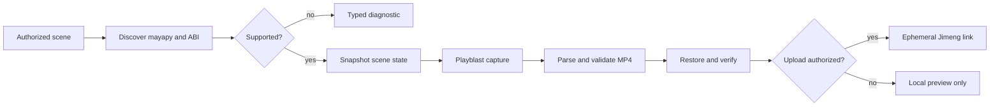

# Autodesk Maya Design

## Plugin marketplaces

This plugin belongs to **AIGC content creation**.

| Category | Marketplace | Purpose |
| --- | --- | --- |
| Full-stack development | [Full Stack Plugins](https://github.com/partme-ai/full-stack-plugins) | Architecture and UI design, code understanding, quality checks, code review, workflow governance, and server operations |
| AIGC content creation | [Full AIGC Plugins](https://github.com/partme-ai/full-aigc-plugins) | Image, video, audio, music, 3D, and multimodal content creation |


> Inspect an authorized Maya scene, capture a reversible Playblast, and optionally return a Jimeng link through the official uploader, with every touched scene value restored afterwards.

[](https://github.com/full-aigc-plugins/maya-design-plugin/releases) [](#skills) [](#installation) [](LICENSE)

[English](README.md) | [简体中文](README.zh-CN.md) · [Install](#installation) · [Quick start](#quick-start) · [Skills](#skills) · [Architecture](docs/Maya-Design-Plugin-Architecture.md) · [Troubleshooting](#troubleshooting)

## Positioning

`maya-design` is a guarded runner, not a Maya reimplementation. It discovers `mayapy` on your machine, snapshots every scene value it is about to change, produces a white-model or material-aware Playblast, validates the resulting MP4 by parsing the container, then restores each snapshot field and verifies the restoration. The plugin never uploads without explicit authorization, never installs Python packages, and keeps local bridge tokens out of durable receipts.

The plugin ships no MCP server: the six Skills call `mayapy` through argv with explicit project and output scopes. The records under `docs/verification/` mark the live Maya path `NOT_RUN`; this README does not claim otherwise.

## Installation

### Prerequisites

- Autodesk Maya 2022 or newer installed on the same machine.
- `mayapy` reachable through `MAYA_LOCATION` or on `PATH`.
- Python 3.7 or newer, matching the interpreter embedded in your Maya build.
- Development only: `jsonschema` from `requirements-dev.txt`.

Maya is commercial software and is not distributed through a package manager. Obtain it from your Autodesk account; the plugin does not download, license or bundle Maya.

### From the plugin marketplace

```bash
codex plugin marketplace add partme-ai/full-aigc-plugins
codex plugin add maya-design@full-aigc-plugins
```

Restart the host and open a new task so the Skills load. Then ask for the diagnostic Skill before touching a scene.

### Confirm the environment

```bash
codex plugin list
```

The entry should read `maya-design@full-aigc-plugins`. After that, run `/maya-diagnose`; it reports the discovered Maya version, Python version and module path count, or a typed failure code such as `MAYA_NOT_FOUND` instead of guessing.

## Quick start



Ask for an inspection first, then a reversible preview:

```text
Inspect this Maya scene and list its cameras, frame range and render settings.
Then render a white-model Playblast from the current camera over the existing range,
restore the scene, and do not upload anything yet.
```

Expected observation: the camera and render settings are listed, the snapshot is taken, the MP4 is validated, and the restoration step confirms each value went back. A mismatch fails with `RESTORE_UNCONFIRMED` instead of reporting success.

## What you can build

| Workflow | Built-in path | Verifiable output |
| --- | --- | --- |
| Read a scene before acting | `maya-inspect` | Scene receipt covering cameras, range, resolution, references and unknown plug-ins |
| Review a preview safely | `maya-export-preview` | White-model or material Playblast plus codec, fps, size and SHA-256 |
| Reuse an existing render | `maya-export-preview` (`existing_video`) | Registered local clip without touching the Maya session |
| Explain a broken environment | `maya-diagnose` | Typed failure code, paths excluded from output |
| Hand a preview to Seedance | `maya-seedance-pipeline` | Validated preview plus a Dreamina 3D handoff (experimental) |

## Skills

| Skill | What it does |
| --- | --- |
| `maya-use` | Routes a vague or orientation request to inspect, export-preview or diagnose. |
| `maya-harness` | Calling spec: read-only preflight, `MAYA_LOCATION` resolution and the no-runtime posture. |
| `maya-inspect` | Read-only scene inventory producing a scene receipt. |
| `maya-export-preview` | Reversible Playblast export with an artifact receipt and restoration status. |
| `maya-diagnose` | Classifies Maya errors without installing anything. |
| `maya-seedance-pipeline` | Drives a validated Playblast through the Dreamina 3D pipeline. |

## Slash commands

| Command | What it does |
| --- | --- |
| `/maya` | Entry point; routes scene inspection, preview and diagnostics. |
| `/maya-inspect` | Read-only scene inspection: hierarchy, references, materials, timeline. |
| `/maya-export-preview` | Reversible Playblast preview and optional Jimeng link. |
| `/maya-diagnose` | Runtime diagnostics: install location, Python, plug-ins and preflight. |
| `/maya-seedance` | Experimental Playblast → Seedance path with validation and download checks. |

## Configuration

| Setting | Where it lives | Notes |
| --- | --- | --- |
| Maya installation | `MAYA_LOCATION` environment variable | Used when `mayapy` is not on `PATH` |
| Maya Python version | `MAYA_PYTHON_VERSION` environment variable | Read during ABI validation |
| Credentials | None | The plugin stores no secret and installs no package |

## Architecture and security

Codex owns orchestration; Maya owns scene data; this plugin owns the snapshot set, the argv-only bridge invocation and the validators. The authors receive no scene data.

- Every temporary change (selection, current time, playback range, camera, active panel, render settings) is snapshotted and compared before and after the run.
- Publication needs an explicit authorization for that specific response, and the returned link is never written into a durable receipt.
- Diagnostics redact local paths; the bridge token exists only inside the `mayapy` subprocess.
- Operations are bounded by a timeout and fail with `TIMEOUT` rather than running indefinitely; nothing retries automatically.

| Evidence | Status |
| --- | --- |
| Offline component suite | Recorded in `docs/verification/offline.md` |
| Real Maya discovery, Playblast capture, browser hand-off | `NOT_RUN`; see `docs/verification/maya-runtime.md` |
| Supported range | Maya 2022+ with `mayapy`; older versions and Linux installs without `MAYA_LOCATION` are out of scope |

## Troubleshooting

| Symptom | Check first | Resolution |
| --- | --- | --- |
| `MAYA_NOT_FOUND` | Maya installation and `MAYA_LOCATION` | Install Maya 2022+ or set `MAYA_LOCATION` |
| `ABI_MISMATCH` | Maya version and embedded Python | Point the runner at a supported Maya |
| `MODULE_LOAD_FAILED` | Maya module path | Fix the environment; the plugin will not install packages |
| `RESTORE_UNCONFIRMED` | The reported field | Inspect the scene before continuing; do not assume it is clean |
| `MEDIA_INVALID` | The produced file | Re-run the Playblast; a parse failure is a hard failure |
| Live behaviour is expected | The runtime record | Only offline behaviour is verified on this host |

## Upgrade

```bash
codex plugin marketplace upgrade full-aigc-plugins
codex plugin add maya-design@full-aigc-plugins
```

Re-run `/maya-diagnose` after an upgrade; the supported Maya range and the receipt contract are versioned, and this release declares receipt contract `1.0.0`.

Current packaged version: `0.2.1+codex.20261018` (development preview).

## Contributing and support

Open functional issues at <https://github.com/full-aigc-plugins/maya-design-plugin/issues>. State the Maya version and Python ABI you verified against, whether the change alters the snapshot set or the receipt shape, and include the affected tests.

## License

Apache-2.0 — see [LICENSE](LICENSE) and [NOTICE](NOTICE).
