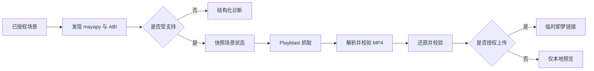

# Autodesk Maya Design

## 插件市场导航

本插件所属分类：**AIGC 内容创作**。

| 分类 | 插件市场入口 | 用途 |
| --- | --- | --- |
| 全栈开发 | [Full Stack Plugins](https://github.com/partme-ai/full-stack-plugins) | 架构与 UI 设计、代码理解、质量检查、代码审查、流程治理与服务器运维 |
| AIGC 内容创作 | [Full AIGC Plugins](https://github.com/partme-ai/full-aigc-plugins) | 图像、视频、音频、音乐、3D 与多模态内容创作 |


> 巡检已授权的 Maya 场景，生成可回滚的 Playblast；如需交接，再经官方上传器返回即梦链接，同时把改动过的场景取值全部还原。

[](https://github.com/full-aigc-plugins/maya-design-plugin/releases) [](#技能) [](#安装) [](LICENSE)

[English](README.md) | [简体中文](README.zh-CN.md) · [安装](#安装) · [快速开始](#快速开始) · [技能](#技能) · [架构文档](docs/Maya-Design-Plugin-Architecture.zh_CN.md) · [故障排查](#故障排查)

## 项目定位

`maya-design` 是受约束的执行器，而不是 Maya 的重写实现。它在本机发现 `mayapy`，对即将改动的每个场景取值做快照，产出白模或保留材质的 Playblast，通过解析容器校验 MP4，然后逐项还原快照字段并校验还原结果。插件不会自行上传、不会安装 Python 包，也不会把本地桥接令牌写进长期回执。

本插件不提供 MCP server：六个技能以 argv 方式调用 `mayapy`，并显式限定工程与输出范围。`docs/verification/` 中的记录把真实 Maya 路径标为 `NOT_RUN`，本 README 不作相反声明。

## 安装

### 前置条件

- 同一台机器上安装 Autodesk Maya 2022 或更新版本。
- `mayapy` 能通过 `MAYA_LOCATION` 找到，或位于 `PATH` 上。
- Python 3.7 或更新版本，需与 Maya 内嵌解释器一致。
- 仅开发调试需要：`requirements-dev.txt` 中的 `jsonschema`。

Maya 是商业软件，不通过包管理器分发。请从 Autodesk 账户获取；插件不会下载、授权或捆绑 Maya。

### 从插件市场安装

```bash
codex plugin marketplace add partme-ai/full-aigc-plugins
codex plugin add maya-design@full-aigc-plugins
```

重启宿主并新建任务，让技能完成加载；随后先运行诊断技能，再触碰具体场景。

### 确认环境

```bash
codex plugin list
```

列表里应出现 `maya-design@full-aigc-plugins`。之后运行 `/maya-diagnose`：它会报告发现的 Maya 版本、Python 版本与模块路径数量，缺失时给出 `MAYA_NOT_FOUND` 这类明确错误码，而不是猜测。

## 快速开始



先巡检，再申请可回滚的预览：

```text
先检查这个 Maya 场景，列出相机、帧范围与渲染设置。
然后用当前相机按现有帧范围渲染一次白模 Playblast，渲染后还原场景，
暂时不要上传任何内容。
```

预期现象：相机与渲染设置被列出，快照已生成，MP4 通过校验，还原步骤确认每个取值都已恢复。任一项不一致会以 `RESTORE_UNCONFIRMED` 失败，而不是报告成功。

## 可完成的工作

| 工作流 | 内置路径 | 可验证输出 |
| --- | --- | --- |
| 动手前先读场景 | `maya-inspect` | 覆盖相机、帧范围、分辨率、引用与未知插件的场景回执 |
| 安全地审阅预览 | `maya-export-preview` | 白模或保留材质的 Playblast，附编码、帧率、尺寸与 SHA-256 |
| 复用已有渲染 | `maya-export-preview`（`existing_video`） | 登记本地视频，完全不触碰 Maya 会话 |
| 解释环境故障 | `maya-diagnose` | 结构化错误码，输出中不含本地路径 |
| 把预览交给 Seedance | `maya-seedance-pipeline` | 已校验预览加 Dreamina 3D 交接（实验性） |

## 技能

| 技能 | 作用 |
| --- | --- |
| `maya-use` | 把含糊或方向性请求路由到巡检、预览或诊断。 |
| `maya-harness` | 调用规范：只读预检、`MAYA_LOCATION` 解析与无运行时的诚实姿态。 |
| `maya-inspect` | 只读场景盘点，产出场景回执。 |
| `maya-export-preview` | 可回滚的 Playblast 导出，附产物回执与还原状态。 |
| `maya-diagnose` | 在不安装任何东西的前提下归类 Maya 错误。 |
| `maya-seedance-pipeline` | 将已校验的 Playblast 接入 Dreamina 3D 链路。 |

## 斜杠命令

| 命令 | 作用 |
| --- | --- |
| `/maya` | 总入口：路由场景巡检、预览与诊断。 |
| `/maya-inspect` | 只读场景巡检：层级、引用、材质与时间轴。 |
| `/maya-export-preview` | 可回滚的 Playblast 预览，可选返回即梦链接。 |
| `/maya-diagnose` | 运行时诊断：安装位置、Python、插件与预检。 |
| `/maya-seedance` | 实验性 Playblast → Seedance 链路，含校验与下载检查。 |

## 配置

| 设置 | 位置 | 说明 |
| --- | --- | --- |
| Maya 安装位置 | `MAYA_LOCATION` 环境变量 | `mayapy` 不在 `PATH` 上时使用 |
| Maya Python 版本 | `MAYA_PYTHON_VERSION` 环境变量 | ABI 校验时读取 |
| 凭据 | 无 | 插件不保存密钥，也不安装依赖包 |

## 架构与安全

Codex 负责编排，Maya 负责场景数据，本插件负责快照集合、argv 方式的桥接调用与校验器；作者不接收任何场景数据。

- 所有临时改动（选择集、当前时间、播放范围、相机、活动面板、渲染设置）都会快照，并在运行前后逐项比对。
- 发布需要针对本次响应的显式授权，返回的链接绝不写入长期回执。
- 诊断会脱敏本地路径；桥接令牌只存在于 `mayapy` 子进程内。
- 操作受超时约束，超时返回 `TIMEOUT` 而不是无限运行；任何步骤都不会自动重试。

| 证据 | 状态 |
| --- | --- |
| 离线组件测试套件 | 记录于 `docs/verification/offline.md` |
| 真实 Maya 发现、Playblast 抓取、浏览器交接 | `NOT_RUN`，见 `docs/verification/maya-runtime.md` |
| 支持范围 | Maya 2022+ 且具备 `mayapy`；更早版本与未设置 `MAYA_LOCATION` 的 Linux 安装不在范围内 |

## 故障排查

| 现象 | 先检查 | 处理 |
| --- | --- | --- |
| `MAYA_NOT_FOUND` | Maya 安装与 `MAYA_LOCATION` | 安装 Maya 2022+，或设置 `MAYA_LOCATION` |
| `ABI_MISMATCH` | Maya 版本与内嵌 Python | 指向受支持的 Maya |
| `MODULE_LOAD_FAILED` | Maya 模块路径 | 修复环境；插件不会安装依赖包 |
| `RESTORE_UNCONFIRMED` | 报错指出的字段 | 继续前先检查场景，不要假定它是干净的 |
| `MEDIA_INVALID` | 产出的文件 | 重新执行 Playblast；解析失败就是硬失败 |
| 期待真实 Maya 行为 | 运行时记录 | 本主机只验证了离线行为 |

## 升级

```bash
codex plugin marketplace upgrade full-aigc-plugins
codex plugin add maya-design@full-aigc-plugins
```

升级后重新运行 `/maya-diagnose`；受支持的 Maya 范围与回执契约都是版本化的，本版本声明回执契约 `1.0.0`。

当前打包版本：`0.2.1+codex.20261018`（开发预览）。

## 贡献与支持

功能问题请提交到 <https://github.com/full-aigc-plugins/maya-design-plugin/issues>。说明你验证所用的 Maya 版本与 Python ABI、改动是否触及快照集合或回执结构，并附上受影响的测试。

## 许可证

Apache-2.0，详见 [LICENSE](LICENSE) 与 [NOTICE](NOTICE)。
